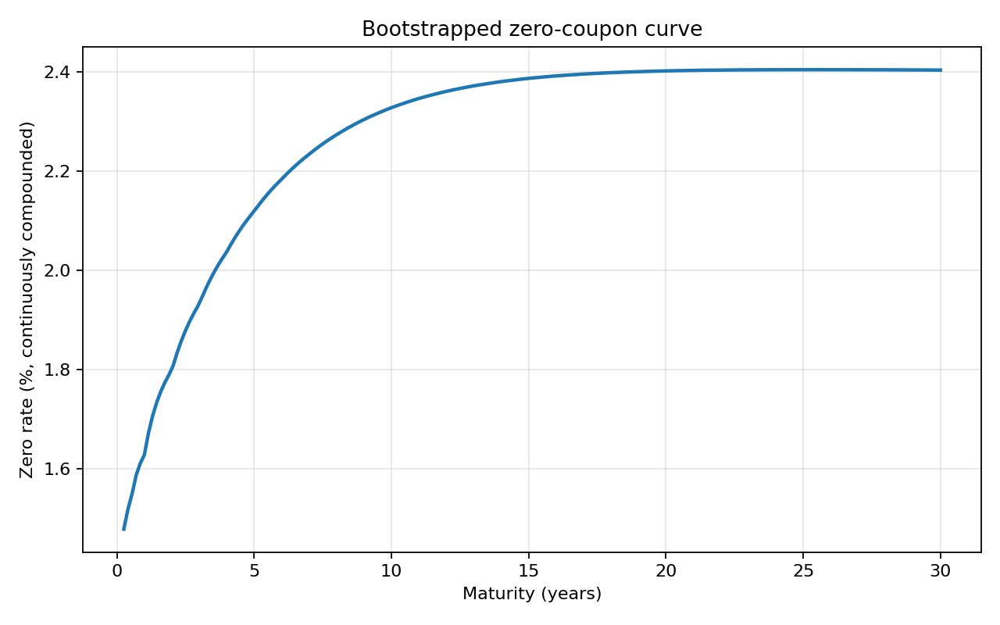
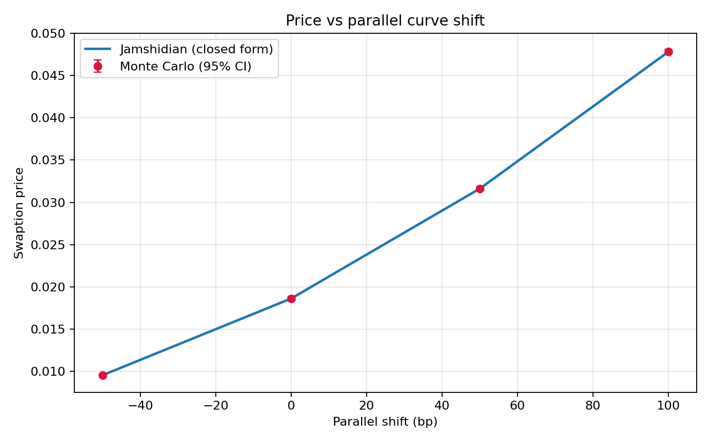
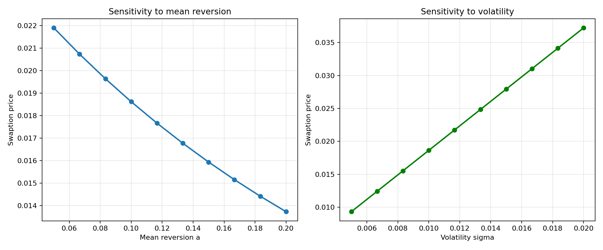

# Hull-White Swaption Pricing

A 2Y x 5Y European ATM payer swaption priced under the one-factor Hull-White model,
two independent ways. The point is that the two methods have to agree, and checking
that they do is what validates the implementation.

## The two methods

**Exact Monte Carlo.** The short rate splits as `r(t) = x(t) + alpha(t)`, with `x` an
Ornstein-Uhlenbeck process and `alpha` a deterministic shift fitted to the market
curve. Everything the payoff needs at expiry sits in the pair `(x(T0), integral of x)`,
which is bivariate Gaussian with a covariance known in closed form. Paths are drawn in
one Cholesky step, so there is no Euler discretisation and no time-stepping bias. The
only error is sampling noise, reported as a standard error.

**Jamshidian decomposition.** Bond prices are monotone in `r(T0)`, so a unique critical
rate `r*` makes the underlying swap worth zero (found with Brent). Exercise happens iff
`r(T0) < r*`, which turns the payoff into a portfolio of puts on zero-coupon bonds,
each priced in closed form. Exact within the model, and a zero-noise benchmark.

## Results

The zero curve the model is calibrated to:

With `a = 10%`, `sigma = 1%`, 200,000 paths, seed 42:

| | |
|---|---|
| ATM forward swap rate | 2.4337% |
| Jamshidian | 0.018624 |
| Monte Carlo | 0.018633 (se 0.000059) |
| Difference | 0.000009, or 0.15 standard errors |

Agreement to a sixth of a standard error means the exact simulation adds no systematic
bias and the root-finding converged.

Delta is 2.22e-04 per +1bp and Gamma 1.61e-06, both computed on the closed form by
centred finite differences so that simulation noise doesn't contaminate them. Both
positive, as a long payer swaption requires.

The price roughly triples from -50bp to +100bp but only halves in the other direction.
That asymmetry is the positive Gamma.

Faster mean reversion compresses the distribution of future rates and lowers the
option; higher volatility raises it.

## Running it

    pip install -r requirements.txt
    python swaption.py

## The data

`data/market_curve.csv` is **simulated**. The original assignment came with a market
curve that isn't mine to redistribute, so the file here is a stand-in built to the same
shape: deposits out to one year, annual par swap rates from 2 to 30, rising from about
1.4% to 2.4%. The results above come from this file, so they are reproducible, but they
are not the ones the original curve produced.

One limitation worth naming: the bootstrap needs every annual maturity quoted, since
each step reuses the discount factors below it. A curve with gaps would need the
missing par rates interpolated first.

